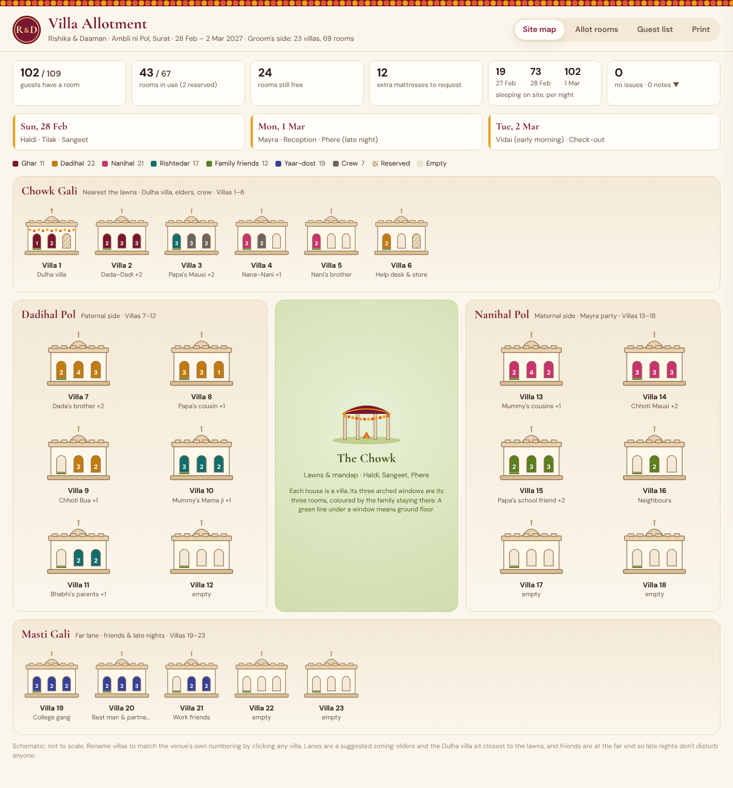

# Rishika ♥ Daaman: Wedding Planning

**Venue:** Ambli ni Pol, Surat · **Dates:** Sun 28 Feb – Tue 2 Mar 2027

| Day | Events |
|---|---|
| Sun, 28 Feb | Haldi · Tilak · Sangeet |
| Mon, 1 Mar | Mayra · Reception · Phere (late night) |
| Tue, 2 Mar | Vidai (early morning) · check-out |

---

## 1. Villa allotment (groom's side)

We have **23 of the 45 villas**. Each villa has **3 rooms**, so we have **69 rooms** in total.

**Shared live version:** https://claude.ai/artifact/KpSiQrPFLNeoivJpFF4j3H. Everyone it's shared with sees the same plan, and changes appear for everyone straight away. Family members with *Contributor* access or above can edit. *Viewers* see it read-only.

You can also open **`index.html`** straight from this repo in any browser. There's nothing to install. Opened that way, the plan is saved only in that browser. Use *Guest list → Save backup* and *Restore backup* to move it between devices.

### The idea: think of the villas as a little *pol*

A *pol* is a cluster of houses along a shared lane, which is what Ambli ni Pol is named after. So the planner draws each villa as a small haveli:

- **Each house is a villa. Each of its 3 arched windows is a room.**
- A window takes the **colour of the family group** staying in it, with a number for how many people are inside.
- A **green line under a window** means a ground-floor room with no stairs. It's for the elders.
- **Hatched windows** are reserved rooms, for example the Dulha's getting-ready room or the gift and Mayra store.
- The **Dulha villa** has a marigold *toran* over its windows.
- A **red or amber dot** on a villa means something needs checking.

The villas are grouped into four suggested **lanes** around **the Chowk** (the lawns and mandap):

| Lane | Villas | Who | Why |
|---|---|---|---|
| **Chowk Gali** | 1–6 | Dulha villa, Ghar (immediate family), all elders, crew | Shortest walk to the mandap for elders. The stylist and pandit ji are close to the Dulha. |
| **Dadihal Pol** | 7–12 | Paternal side (Tau, Chacha, Bua) and their relatives | Keeps each side together, so their gossip and chai stay in one place |
| **Nanihal Pol** | 13–18 | Maternal side (Mama, Mausi) | The Mayra party gets ready together on 1 Mar |
| **Masti Gali** | 19–23 | Daaman's friends | Far end, so after-party noise doesn't wake Dadi |

> The lanes are a schematic, not the real site plan. Once we have the venue map, click any villa to rename it to the venue's number and move it to the right lane.

### Family groups (colour key)

| Colour | Group | Who |
|---|---|---|
| Maroon | **Ghar** | Groom's immediate family |
| Haldi gold | **Dadihal** | Paternal side |
| Rani pink | **Nanihal** | Maternal side (Mayra hosts) |
| Peacock teal | **Rishtedar** | Extended relatives |
| Mehendi green | **Family friends** | Parents' friends, neighbours |
| Indigo | **Yaar-dost** | Daaman's friends |
| Stone | **Crew** | Pandit ji, stylist, helpers, drivers |

### Four views

1. **Site map**: the illustrated overview above, for the family WhatsApp group and for seeing gaps at a glance.
2. **Allot rooms**: a drag-and-drop board. The left column lists families who still need a room.
   - Drag a **family header** to move the whole family. It fills that room, then spills into the villa's other free rooms.
   - Drag a **single name** to move one person.
   - On a phone, **tap** a name or family, then **tap a room**.
   - **Suggest rooms** places everyone who is left, following the rules below. After that, you adjust by hand. Bulk actions can be undone.
3. **Guest list**: an editable table for name, family, group, elder or kid, the nights they stay, phone and room. It also has CSV import and export, plus backup and restore.
4. **Door cards**: a card for each villa's door, plus an A–Z "who is where" sheet for the help desk. Use *Save printable page* to download them, then print.

### Rules the planner follows and checks

- **Families stay together**, in the same villa where possible.
- **Elders get ground-floor rooms** in Chowk Gali, close to the lawns.
- **Room capacity:** 2 adults is comfortable and 3 is the maximum with an extra mattress. A kid counts as half a bed.
- **Checked night by night** (27 Feb, 28 Feb, 1 Mar). A room is only "full" on the nights people actually sleep there. So a family that leaves after the Sangeet can hand its room to someone arriving for the Reception.
- **Issues flagged:**
  - an over-full room
  - an elder upstairs
  - a kid in a villa without a parent
  - a reserved room with guests in it
  - a family split across villas
- **Live numbers:**
  - guests placed
  - free rooms
  - **extra mattresses to request from the venue**
  - **headcount per night**, which the caterer also needs for breakfast counts

### Guests are families, with headcounts

Each entry is one family (a party) with an **adult and kid counter**, the city it's **coming from**, where it **stays** (villa room, hotel, or own arrangement), and how many **rooms it needs**. Set rooms to 0 when a family shares a room with others ("adjust"). A family that needs 2 rooms is split evenly across them when the planner checks beds.

Each villa has **Rooms A, B, C and a Hall**. Every room and hall has a beds count (2 for rooms, 0 for halls) and an **extra mattress counter**. "Sleeps" = beds + mattresses. The planner checks every room night by night, and tells you how many more mattresses a room needs.

The Guest list filters by **side, family, city and stay**. City chips at the top show how many families and people come from each place, which also helps with planning pickups.

### Importing the guest sheet

*Guest list → Import sheet* takes the family Excel sheet as it is (`.xlsx`): **Family Name, Relation, Count bade, Count Chote, Coming from, Room dena, Room Count, Must Have, Mama Paksh, Behen Betiya, Close relatives**. It also takes a CSV in this planner's own format; see [`data/guest-list-template.csv`](data/guest-list-template.csv).

- **Side:** Bhai becomes Bhai-bandhu, Behn/beti and Bhatiji become Behn-Beti, Mama becomes Mama paksh, Relative becomes Relatives, Friend becomes Friends, and Pandit becomes Pandit & crew. Blank relations use the sheet's tick columns.
- **Family:** shared surnames become families (Pansari, Goyal, Agarwal, Gudawala, Rajlaxmi…).
- **Stay:** Room dena = 1 means a villa room, and blank means own arrangement. A Room Count of "Adjust" means the family shares.

### To confirm with Ambli ni Pol

- [ ] Site map with real villa numbers, and which villas are ours (to replace the schematic)
- [ ] Which rooms are ground floor, and whether villas have stairs
- [ ] Bed type per room (double or twin) and how many extra mattresses they can provide
- [ ] Check-in time on 27/28 Feb and late check-out on 2 Mar, after the early-morning Vidai
- [ ] Whether the bride's side's 22 villas are a separate cluster (helpful for Baraat routing)
